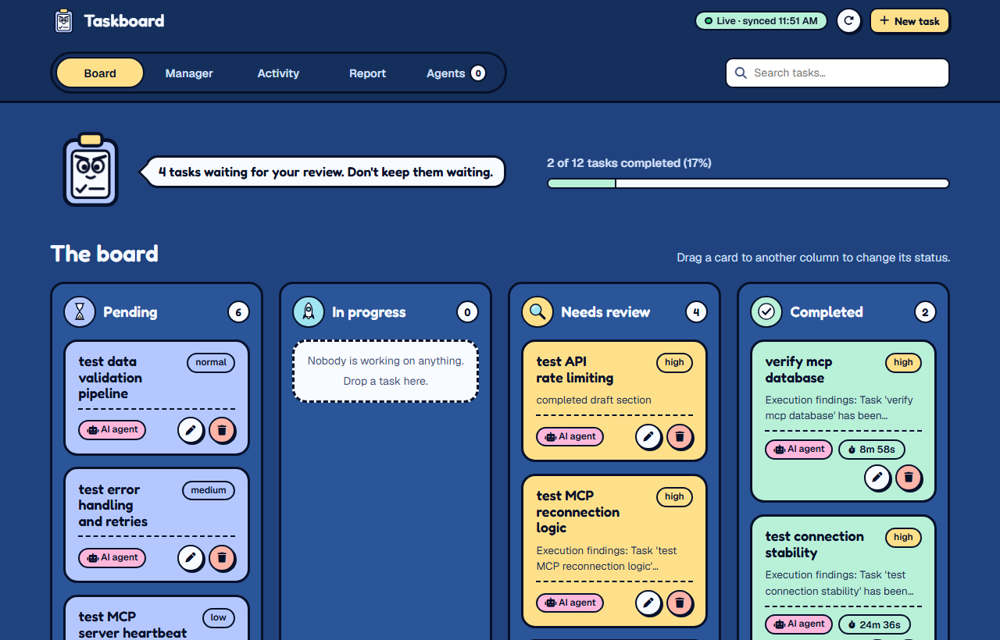
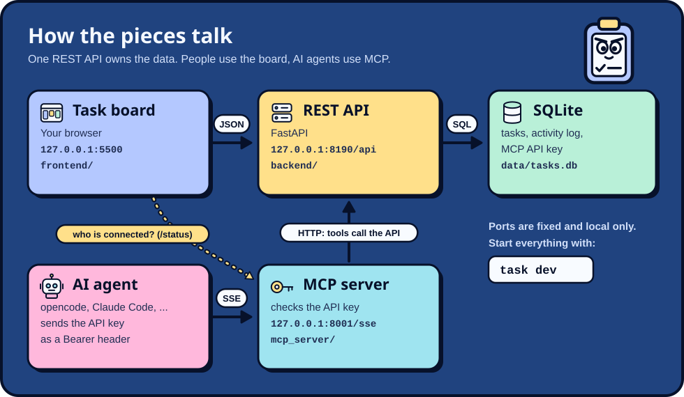
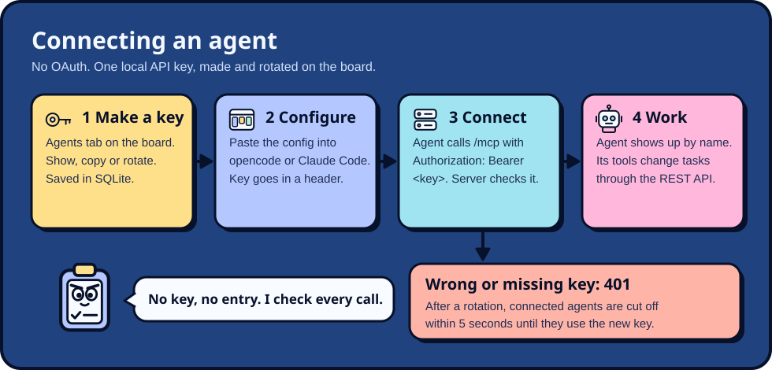
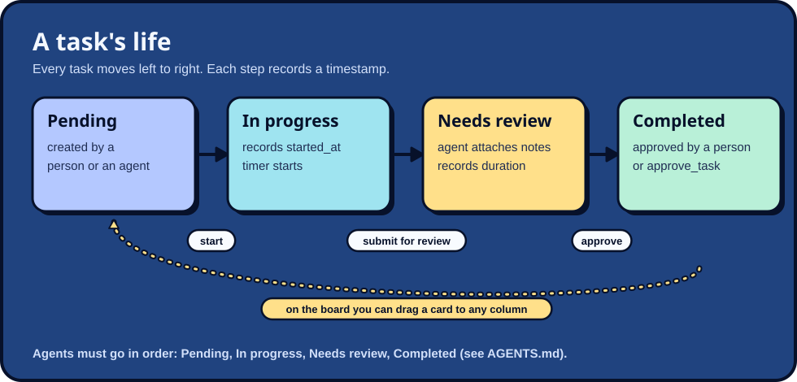
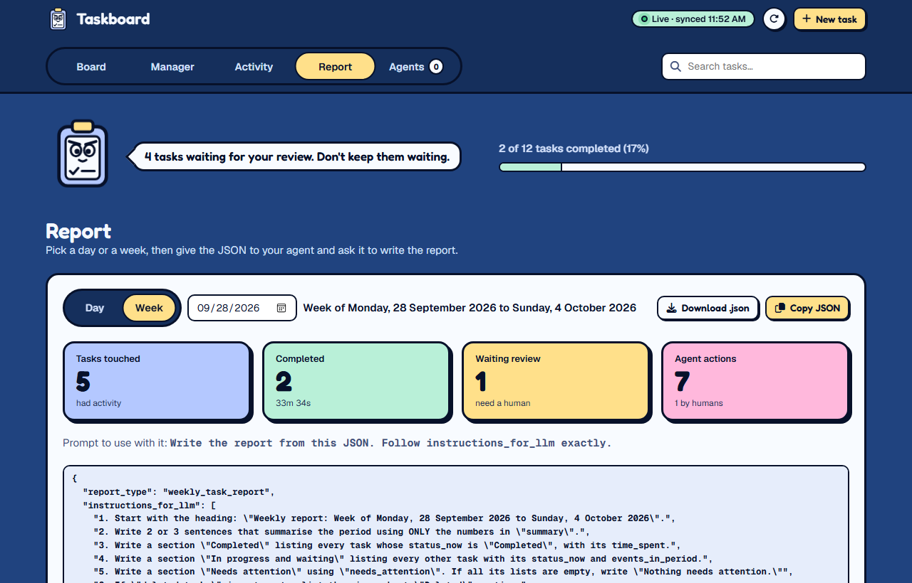

# MCP Task Manager

A local task board that people and AI agents share. People drag cards around in the browser; AI agents (opencode, Claude Code, anything that speaks [MCP](https://modelcontextprotocol.io)) work the same tasks through MCP tools. Every change from either side lands in one activity log, so you can always see who did what.

It runs only on your machine (`127.0.0.1`). Nothing is deployed.

<p align="center"></p>

## Contents

- [How it works](#how-it-works)
- [Quick start](#quick-start)
- [Commands](#commands)
- [Connect an AI agent](#connect-an-ai-agent)
- [The task lifecycle](#the-task-lifecycle)
- [Using the board](#using-the-board)
- [MCP tools](#mcp-tools)
- [REST API](#rest-api)
- [Project layout](#project-layout)
- [Environment variables](#environment-variables)
- [Troubleshooting](#troubleshooting)
- [Docs](#docs)

## How it works

<p align="center"></p>

| Part | Address | Code | Job |
| --- | --- | --- | --- |
| Task board | `http://127.0.0.1:5500` | `frontend/` | The web UI. Plain HTML, CSS and JavaScript, no build step. |
| REST API | `http://127.0.0.1:8190/api` | `backend/` | FastAPI. The only thing that reads or writes the database. |
| MCP server | `http://127.0.0.1:8001/sse` | `mcp_server/` | Gives AI agents task tools. Checks the API key on every request. |
| Database | `data/tasks.db` | `backend/database.py` | SQLite: tasks, the activity log, and the MCP API key. Created on first start. |

The MCP server never touches the database itself: its tools call the REST API, so people and agents follow exactly the same rules.

## Quick start

You need [uv](https://docs.astral.sh/uv/) (Python manager) and [Task](https://taskfile.dev/) (command runner).

```bash
uv sync      # install Python and dependencies
task dev     # start the REST API, MCP server and board together
```

Open **http://127.0.0.1:5500**. The header shows **Live · synced** when the board can reach the API.

No Task? Run each part in its own terminal from the repo root:

```bash
uv run uvicorn app:app --app-dir backend --host 127.0.0.1 --port 8190 --reload
uv run python mcp_server/server.py
uv run python -m http.server 5500 --bind 127.0.0.1 -d frontend
```

## Commands

Run `task` on its own to list these.

| Command | What it does |
| --- | --- |
| `task install` | `uv sync`: install dependencies |
| `task dev` | Start the REST API, MCP server and board together (Ctrl+C stops all three) |
| `task backend` | REST API on :8190, reloads when backend code changes |
| `task mcp` | MCP server on :8001. Needs the backend running |
| `task frontend` | Serve the board on :5500 |
| `task report` | Print the last 7 days of activity in the terminal |
| `task check-mcp` | End-to-end check of the API key gate. **Rotates the key at the end** |

## Connect an AI agent

<p align="center"></p>

Agents need an API key. There is one key, it lives in the database, and you manage it on the board's **Agents** tab: **Show**, **Copy key**, **Rotate key**.

1. Start everything with `task dev` and open the **Agents** tab.
2. Press **Copy config** (opencode) or **Copy command** (Claude Code) on that tab. The copied text already contains the key.
3. Start your agent. Within 5 seconds it appears under **Connected agents** with its name and version.

**opencode.** Paste the copied config into your opencode config. The `opencode.json` committed in this repo can't hold the key (it would put a secret in git), so it reads it from the `TASKBOARD_MCP_KEY` environment variable instead:

```json
"todo-list-server": {
  "type": "remote",
  "url": "http://127.0.0.1:8001/sse",
  "headers": { "Authorization": "Bearer {env:TASKBOARD_MCP_KEY}" }
}
```

**Claude Code:**

```bash
claude mcp add --transport sse todo-list-server http://127.0.0.1:8001/sse --header "Authorization: Bearer <your key>"
```

**Any other MCP client:** connect to `http://127.0.0.1:8001/sse` and send `Authorization: Bearer <key>` (or `X-API-Key: <key>`) on every request.

Good to know:

- The agent's name comes from the MCP handshake (for example `opencode`). Send an `X-Agent-Name` header to show a name of your choice instead.
- A missing or wrong key gets `401`. If the REST API is down, the MCP server answers `503`, because it can't check the key.
- **Rotating** the key cuts off every connected agent within 5 seconds. They show as **Old key: reconnect** until you give them the new key.

## The task lifecycle

<p align="center"></p>

| Status | Meaning | What gets recorded |
| --- | --- | --- |
| **Pending** | Waiting for someone to pick it up | `created_at` |
| **In progress** | Being worked on; the card shows a live timer | `started_at` |
| **Needs review** | Work is done and waiting for a person to check it | `completed_at`, `duration_ms` |
| **Completed** | Approved | `completed_at`, `duration_ms` |

Agents must move tasks in this order and attach their results when they hand a task over for review (see [AGENTS.md](AGENTS.md)). People can drag a card to any column.

## Using the board

The header has five tabs, a search box (filters the Board and Manager), and **New task**.

| Tab | What it's for |
| --- | --- |
| **Board** | Kanban columns. Drag a card to change its status. Each card has **Edit** and **Delete** buttons; click the card for details, subtasks and that task's full history. |
| **Manager** | All tasks in one table with status, creator and duration. |
| **Activity** | Every action, newest first. Filter by **All**, **Agent** or **Human**. |
| **Report** | Builds a JSON summary of a day or a week for an AI to write up (below). |
| **Agents** | Is the MCP server running, which agents are connected, and the API key. |

Cards made by an agent carry a pink **AI agent** chip; cards made by people say **Human**. If the API is offline, the board keeps working in your browser and the header says **Offline · saving locally**.

### Reports

The board doesn't write reports. It hands you clean JSON that any LLM, even a small one, can turn into a report.

1. Open **Report** and pick **Day** or **Week** (Monday to Sunday), then a date.
2. Press **Copy JSON** or **Download .json**.
3. Give it to your agent with: *"Write the report from this JSON. Follow instructions_for_llm exactly."*

<p align="center"></p>

The JSON is built to be followed literally:

| Key | Contains |
| --- | --- |
| `instructions_for_llm` | Numbered steps: heading, summary, sections, and "never invent facts" |
| `period` | Day or week, a readable label, exact start and end with timezone |
| `summary` | Counts: tasks with activity, created, started, moved to review, completed, deleted, time spent, human vs agent actions |
| `needs_attention` | Titles waiting for review, overdue, still in progress |
| `tasks` | One entry per task touched in the period: status, `events_in_period`, time spent, subtasks, and its activity |
| `deleted_tasks` | Tasks deleted in the period |
| `per_day` | Week reports only: completions and actions for each day |
| `field_guide` | A plain-English meaning for the trickier keys |

## MCP tools

What a connected agent can call ([details](docs/mcp-tools.md)):

| Tool | What it does |
| --- | --- |
| `get_tasks` | List every task. Agents call this before changing anything. |
| `add_task(title, description, priority)` | Create a task (marked as made by an agent) |
| `update_task_status(task_id, status, description)` | Move a task to the next status |
| `update_task_details(task_id, description, subtasks)` | Attach results, notes or a subtask checklist |
| `approve_task(task_id)` | Move one task from Needs review to Completed |
| `bulk_approve_tasks()` | Approve every task in Needs review |
| `delete_task(task_id)` | Delete a task |

## REST API

Base URL `http://127.0.0.1:8190/api` ([details](docs/task-api.md)). Browsers may only call it from the board's own address, so other websites can't read your key or change your tasks.

| Method and path | What it does |
| --- | --- |
| `GET /tasks` | All tasks |
| `POST /tasks` | Create or update a task (same body for both) |
| `DELETE /tasks/{id}` | Delete a task |
| `GET /audit` | The activity log |
| `GET /mcp/key` | The current MCP API key |
| `POST /mcp/key/rotate` | Make a new key; the old one stops working |

## Project layout

```text
backend/
  app.py            REST API (FastAPI)
  database.py       SQLite schema, settings and activity log helpers
  report.py         terminal activity report (task report)
mcp_server/
  server.py         MCP tools + the API key gate and agent tracking
  check_gate.py     end-to-end check of the gate (task check-mcp)
frontend/
  index.html        the board (all five tabs)
  script.js         board logic: rendering, drag and drop, reports, agents
  style.css         Inkpop design system + board styles
docs/               rules, flows, decisions (start at docs/index.md)
  diagrams/         the diagrams in this README
data/tasks.db       the database (gitignored, created on first start)
logs/               MCP server logs (gitignored)
Taskfile.yaml       the task commands
opencode.json       MCP config for opencode (key from TASKBOARD_MCP_KEY)
```

## Environment variables

None. Ports are fixed in the code, and the API key is created, stored and rotated by the board (Agents tab), so there is no `.env` file.

The only optional variable is for opencode run from this repo: the committed `opencode.json` reads the key from `TASKBOARD_MCP_KEY`. Set it in the shell that starts opencode, or skip it and paste the config from the Agents tab instead.

| Name | Used by | Value |
| --- | --- | --- |
| `TASKBOARD_MCP_KEY` | `opencode.json` (`{env:TASKBOARD_MCP_KEY}`) | The key from the Agents tab (**Copy key**) |

## Troubleshooting

| Symptom | Fix |
| --- | --- |
| Header says **Offline · saving locally** | The REST API isn't running. Start it with `task backend` or `task dev`. |
| Agents tab says **MCP server offline** | Run `task mcp`. It needs the REST API running first. |
| Agent gets `401` | The key is missing or old (it was rotated). Copy the config or key again from the Agents tab. |
| Agent gets `503` | The MCP server can't reach the REST API to check the key. Start the backend. |
| `task dev` fails with "address already in use" (Windows) | An earlier run left Python processes behind. Find them with `netstat -ano \| findstr ":8190 :8001 :5500"` and stop them with `taskkill /PID <pid> /T /F`. |
| Backend changes don't show up | The auto-reload sometimes misses edits on Windows. Stop and rerun `task backend`. |

## Docs

- [docs/index.md](docs/index.md): what everything is and where to find it
- [docs/flows/](docs/flows/index.md): what happens step by step (task lifecycle, agent updates)
- [docs/adrs/](docs/adrs/index.md): why things are the way they are
- [AGENTS.md](AGENTS.md): rules for AI agents working on this repo. Check docs with `uv run scripts/check_docs.py`.
