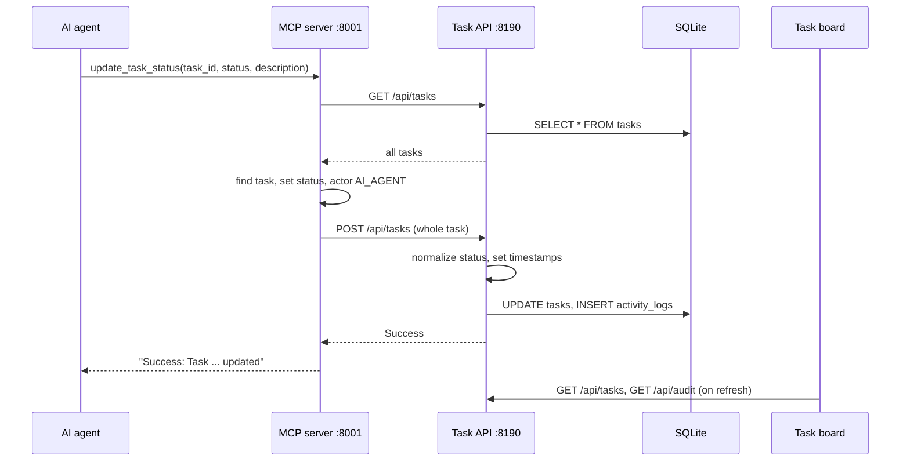

# Flow: an agent updates a task

Agents and people share one task list, so an agent's change must land in the same database and log that the board reads. ([ADR 0003](../adrs/0003-agents-use-mcp-server-over-rest-api.md))

## Steps in order

1. The agent calls an MCP tool over SSE. The tool logs the call to stderr and the MCP log file.
2. The MCP server fetches every task from `GET /api/tasks` and picks the one with the matching id. If none matches, it returns "not found" and stops.
3. It changes the fields in memory and sets `actor` to `AI_AGENT`. `update_task_status` and `approve_task` also compute `started_at`, `completed_at`, and `duration_ms` themselves.
4. It POSTs the whole task to `/api/tasks`.
5. The API normalizes the status. For an existing task it keeps its stored timestamps and sets new ones only on a status change ([lifecycle](task-lifecycle.md)), so the MCP server's timestamps from step 3 are ignored.
6. The API updates the `tasks` row and adds one `UPDATE_TASK` row to `activity_logs`.
7. The board shows the change the next time it loads data.

## How it fails

| What | Result |
| --- | --- |
| Task API not running | The tool returns an error string such as "Failed to update task: ..." and logs an ERROR |
| Unknown `task_id` | The tool returns "Task X not found." Nothing is written |
| `approve_task` on a task not in Needs Review | The tool refuses and names the current status. Nothing is written |
| A POST fails inside `bulk_approve_tasks` | The failure is not checked; the task is still counted as approved |
| Board is open | It does not see the change until it reloads data |

## Source

`mcp_server/server.py`, `backend/app.py`, `backend/database.py`, `frontend/script.js`.

## More

[MCP tools](../mcp-tools.md), [Task API](../task-api.md), [Task board](../task-board.md).
