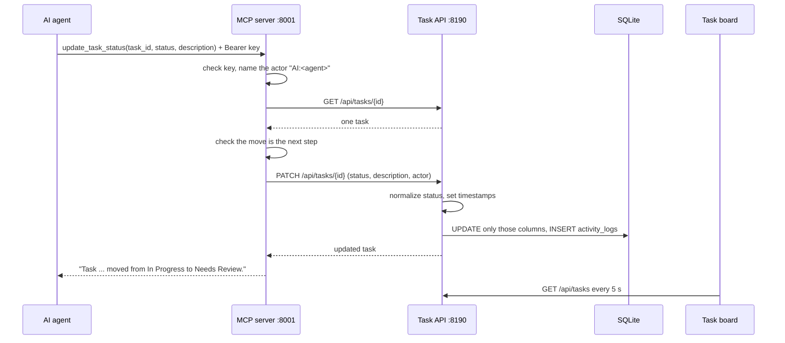

# Flow: an agent updates a task

Agents and people share one task list, so an agent's change must land in the same database and log that the board reads, without wiping what a person changed at the same time. ([ADR 0003](../adrs/0003-agents-use-mcp-server-over-rest-api.md))

## Steps in order

1. The agent calls an MCP tool over Streamable HTTP (`/mcp`) or SSE (`/sse`) with its API key. The gate checks the key; the tool names the actor `AI:<agent name>` (from the `X-Agent-Name` header or the MCP handshake).
2. The tool reads the one task with `GET /api/tasks/{id}`. A 404 returns "Task X not found." and stops.
3. `update_task_status` checks the move: only Pending to In Progress, or In Progress to Needs Review (with results in `description` or existing subtasks). Anything else returns a message naming the allowed next step; nothing is written.
4. The tool sends only the changed fields with `PATCH /api/tasks/{id}`.
5. The API normalizes the status, sets timestamps on a status change ([lifecycle](task-lifecycle.md)), updates only those columns, and adds one `UPDATE_TASK` row to `activity_logs` with the agent's actor name. Timestamps are UTC.
6. The board picks up the change on its next 5-second refresh.

## How it fails

| What | Result |
| --- | --- |
| Missing or old API key | `401`; after a rotation the open connection is closed within 5 seconds |
| Task API not running | The tool returns "Task API error: ..." and logs an ERROR; the gate answers `503` to new requests |
| Unknown `task_id` | The tool returns "Task X not found." Nothing is written |
| Skipped step, or Completed without `approve_task` | The tool refuses and names the next allowed step. Nothing is written |
| A person edits the same task at the same time | Both survive unless they changed the same field; then the later write wins for that field |
| A PATCH fails inside `bulk_approve_tasks` | The task is listed under "Failed" in the result; the others are still approved |

## Source

`mcp_server/server.py`, `backend/app.py`, `backend/database.py`, `frontend/script.js`. Checked by `task check-mcp` and `task check-api`.

## More

[MCP tools](../mcp-tools.md), [Task API](../task-api.md), [Task board](../task-board.md).
