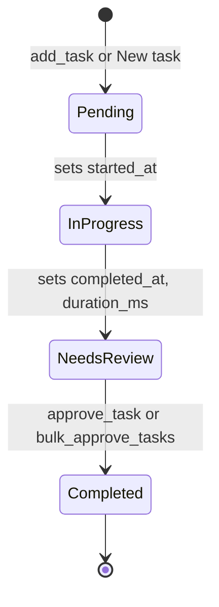

# Flow: a task's lifecycle

Durations on the board are only right when a task passes through every status in order. ([ADR 0004](../adrs/0004-four-step-task-lifecycle-with-approval.md))

`InProgress` is `In Progress` and `NeedsReview` is `Needs Review` in the stored data.

## Steps in order

1. **Pending.** A task is created by `add_task` (creator `AI:<agent name>`) or the board (creator `human`). The API writes the `tasks` row and a `CREATE_TASK` log row.
2. **In Progress.** On the first move here the API sets `started_at`. The board starts a live timer.
3. **Needs Review.** The API sets `completed_at` and `duration_ms` from `started_at`. `update_task_status` refuses this move unless the agent passes its results in `description` or the task already has subtasks.
4. **Completed.** `approve_task` or `bulk_approve_tasks` moves the task here. Because the status changed, the API sets `completed_at` and `duration_ms` again, so the final duration runs until approval.

Each move adds one `UPDATE_TASK` row to `activity_logs`. All timestamps are UTC.

## Who may move what

| Mover | Allowed moves | Enforced in |
| --- | --- | --- |
| An agent (MCP tools) | Only the next step; Completed only through `approve_task` / `bulk_approve_tasks` | `mcp_server/server.py` (`NEXT_STATUS`) |
| A person (board) | Any column, by drag, touch drag, or the status picker | Not enforced, on purpose |
| Any caller of the REST API directly | Any status | Not enforced |

## How it fails

| What | Result |
| --- | --- |
| An agent skips a step | The tool refuses and names the next step |
| A person drags Pending straight to Needs Review or Completed | Allowed. `started_at` is empty, so `duration_ms` stays empty and no duration shows |
| A status spelled oddly (`in-progress`) | The API stores `Pending`; the MCP tool answers "Unknown status" |
| Moving back to In Progress | `started_at` is kept, so the timer continues from the first start |

## Source

`backend/app.py`, `mcp_server/server.py`, `frontend/script.js`. Checked by `task check-mcp`.

## More

[Task API](../task-api.md), [MCP tools](../mcp-tools.md), [agent update flow](agent-task-update.md).
